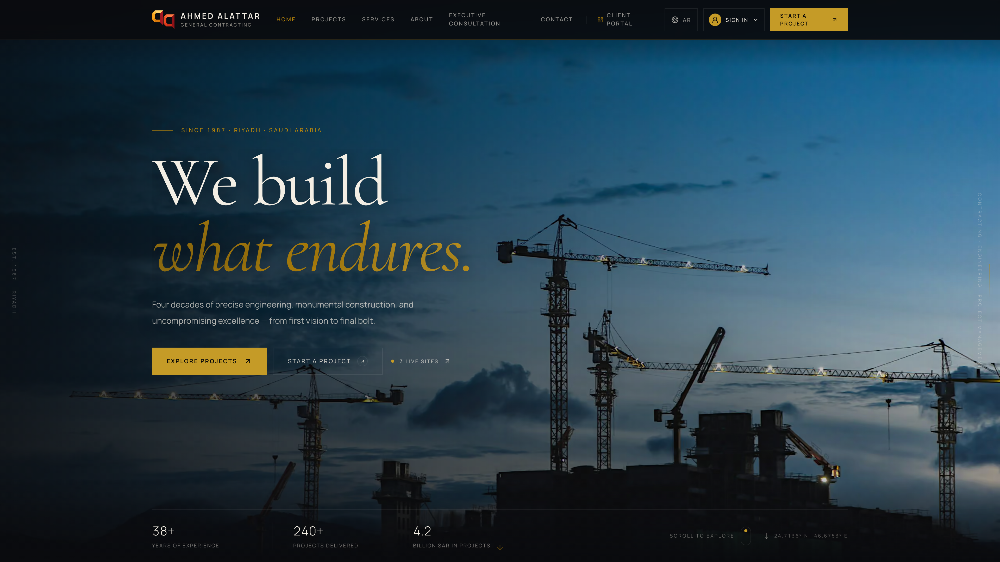

# Ahmed Alattar General Contracting — Digital Platform

## نظرة عامة تنفيذية / Executive Portfolio Overview

> **Arabic-first. Security-led. Built for enterprise construction operations.**

This document is the portfolio companion for the Ahmed Alattar General Contracting Co. web platform. It combines the public luxury experience, the client transparency portal, and the independent administrative control center into one production-grade application. The screenshots in this folder are generated automatically from the running product — not mocked designs — using the Playwright suite in `tests/portfolio-showcase.spec.ts`.

> **Capture policy:** every asset is forced to **English (LTR)** and captured from a **16:9 landscape viewport**. Standard views use **1920 × 1080** at `deviceScaleFactor: 2` → **3840 × 2160 (4K)**; the full admin table uses **2560 × 1440** → **5120 × 2880**, and the compact status-filter view uses **1600 × 900** → **3200 × 1800**. The generator asserts locale, direction, viewport ratio, PNG signature, and exported image ratio before writing each file.

> ملاحظة تسمية المجلد: تم استخدام `portfolio-showcase/` كاسم ASCII آمن للتنقل عبر أنظمة CI وWindows، وهو الاسم التقني المكافئ لمجلد **«احترافي»**. جميع اللقطات باللغة الإنجليزية وباتجاه أفقي.

---

## ١. الملخص التنفيذي (العربية)

منصة رقمية متكاملة لشركة أحمد العطار للمقاولات العامة، مصممة لتحويل المشاريع الضخمة من ملفات ورسائل متفرقة إلى تجربة شفافة ومركزية تخدم الإدارة والعميل والزائر في آن واحد.

**القيمة التجارية:**
- **ثقة العميل:** بوابة خاصة تعرض المراحل والمستندات والفواتير والتقدم المالي لحظة بلحظة، مع توقيع عقد رقمي موثّق ببصمة تشفيرية.
- **سرعة القرار:** لوحة إدارة مستقلة تجمع مؤشرات الأداء وصحة الميزانيات والاستفسارات والعقود والمشاريع في واجهة واحدة داكنة فاخرة.
- **تحويل أعلى:** موقع عام سينمائي متعدد اللغات يُبرز المشاريع بأسلوب تحريري راقٍ ويشجع على طلب الاستشارة.
- **جاهزية إنتاجية:** حماية أمنية صارمة تشمل CSRF، وتحديد معدل الطلبات، وتحقق Zod، ومنع IDOR، وحماية NoSQL، وتشفير كلمات المرور بـ bcrypt.

**النهج المعماري:** تم فصل واجهة الجمهور عن «شلّ الإدارة» تماماً؛ فالإدارة لا تظهر في تنقل الموقع العام، وتحمّل جلساتها ومساراتها الخاصة. البوابة والإدارة كلاهما محميان على مستوى الـ proxy وعلى مستوى الـ route، مع تحقق حي من إصدار الجلسة حتى تُسحب الصلاحيات فوراً.

---

## 2. Executive summary (English)

A unified digital platform for Ahmed Alattar General Contracting Co. that turns complex mega-project delivery into a transparent, secure, and premium experience for three audiences: the public, assigned clients, and internal administrators.

**Business value:**
- **Client confidence:** a private portal with live milestones, documents, invoices, financial tracking, and cryptographically digested contract sign-off.
- **Faster decisions:** a dedicated admin control center with KPIs, budget health, inquiries, signed-contract metrics, and a responsive project management table in a dark luxury theme.
- **Higher conversion:** a cinematic bilingual public site with an interactive project catalog and editorial-grade presentation.
- **Production readiness:** CSRF defence, IP + identifier rate limiting, strict Zod validation, IDOR prevention, NoSQL injection guards, bcrypt password hashing, hardened headers, and fail-closed production configuration.

**Architectural stance:** the public site and the admin shell are deliberately decoupled. Admin navigation is never mixed into public chrome; admin and portal routes are guarded both by the proxy layer and by route-level checks, with live session-version reconciliation for immediate revocation.

---

## 3. معرض اللقطات / Visual showcase

All **24** assets below are **English, LTR, landscape, and 16:9**. No Arabic, portrait, tablet, or mobile captures are included in this showcase set.

### Public marketing & experience — 6 views

| # | Critical view | What it demonstrates | Capture |
| --- | --- | --- | --- |
| 01 | Homepage hero & cinematic 3D section | Cinematic intro, editorial typography, and the lazy-loaded Three.js / R3F WebGL accent | [Hero](01-public-homepage-hero-wide.png) |
| 02 | Interactive projects catalog & filters | Search, filter chips, project cards, and the interactive catalog grid | [Catalog](01-public-projects-catalog-filters-wide.png) |
| 03 | Project preview modal | Accessible `role="dialog"` preview with gallery, scope, and full-page CTA | [Modal](01-public-project-preview-modal-wide.png) |
| 04 | Project detail deep dive | Full project narrative, scope, cost visualizer, and related projects | [Detail](01-public-project-detail-wide.png) |
| 05 | Public consultation & bid form | Multi-step RFQ with attachments, consent, and validation states | [Contact](01-public-contact-bid-form-wide.png) |
| 06 | Executive consultation booking | Available dates, session modes, and the executive booking form | [Booking](01-public-consultation-booking-wide.png) |

### Client transparency portal — 5 views

| # | Critical view | What it demonstrates | Capture |
| --- | --- | --- | --- |
| 07 | Portal overview & live metrics | Signed-in dashboard with assigned projects, progress, and live financial summary | [Overview](02-portal-overview-metrics-wide.png) |
| 08 | Projects assigned to client | Ownership-scoped project list derived from the signed session | [Projects](02-portal-assigned-projects-wide.png) |
| 09 | Live milestones & progress tracker | Timeline, current milestone, and completion progress | [Milestones](02-portal-milestones-progress-wide.png) |
| 10 | Financial breakdown & invoices | Contract value, spend, remaining balance, invoice states, and payment statuses | [Financials](02-portal-financials-invoices-wide.png) |
| 11 | Secure contract signing & digest | Consent-gated digital signature, contract hash, and milestone verification gate | [Signing](02-portal-contract-signing-digest-wide.png) |

### Independent admin shell & control center — 13 views

| # | Critical view | What it demonstrates | Capture |
| --- | --- | --- | --- |
| 12 | Admin dashboard KPIs & budget health | Dark luxury shell, KPI metrics, active-project alerts, and budget panels | [Dashboard](03-admin-dashboard-kpis-wide.png) |
| 13 | Full projects management table | Ultra-wide 5120 × 2880 table with all responsive columns visible | [Full table](03-admin-projects-table-full-wide.png) |
| 14 | Bulk actions bar | Gold selection state with the bulk operations toolbar engaged | [Bulk bar](03-admin-projects-bulk-actions-wide.png) |
| 15 | Status filters | Compact 3200 × 1800 landscape view with the "Ongoing" filter active | [Filters](03-admin-projects-status-filters-wide.png) |
| 16 | Milestones management | Financial milestones and completion tracking | [Milestones](03-admin-milestones-management-wide.png) |
| 17 | Contracts management | Contract records, sign-off state, and digest visibility | [Contracts](03-admin-contracts-management-wide.png) |
| 18 | Consultations management | Executive consultation requests and booking state | [Consultations](03-admin-consultations-management-wide.png) |
| 19 | Inquiries management | Public RFQ and contact leads in the admin pipeline | [Inquiries](03-admin-inquiries-management-wide.png) |
| 20 | Financials | Portfolio financial performance and margin reporting | [Financials](03-admin-financials-wide.png) |
| 21 | Content management / CMS | Editable bilingual copy and homepage content fields | [Content](03-admin-content-management-wide.png) |
| 22 | Media library | Banners, project imagery, and media overrides | [Media](03-admin-media-library-wide.png) |
| 23 | Audit trail | Security and activity log with actor/action metadata | [Audit](03-admin-audit-trail-wide.png) |
| 24 | Maintenance | Operational maintenance and data-integrity controls | [Maintenance](03-admin-maintenance-wide.png) |

### Featured capture — English widescreen



---

## 4. Tech stack / التقنيات

| Layer | Technology | Why it matters |
| --- | --- | --- |
| Framework | **Next.js 16 (App Router)** | Server components, streaming, proxy-level guards, and file-based route isolation. |
| UI | **React 19 + TypeScript (strict)** | Typed contracts from database payloads through API responses to UI state. |
| Styling | **Tailwind CSS 4.3** | Utility-first luxury design system with gold accents, glass surfaces, and responsive micro-layouts. |
| Motion | **Framer Motion** | Cinematic reveals, modal choreography, and admin shell transitions. |
| 3D | **Three.js + React Three Fiber** | Client-only procedural WebGL accent in the hero; decorative, pointer-transparent, and lazy-loaded so it never blocks LCP. |
| Data | **MongoDB + Mongoose 9** | Canonical project/content records, strict schemas, `select: false` secret fields, ownership indexes. |
| Validation | **Zod 4** | Strict request contracts, unknown-field rejection, sanitization, and recursive NoSQL-operator rejection. |
| Auth | **Signed JWT cookies + bcryptjs (cost 12)** | `HttpOnly`, `Secure`, `SameSite=Strict`, session rotation, live `sessionVersion` checks. |
| Notifications | **Resend + WhatsApp API/webhook** | Instant admin alerts for inquiries, consultations, contracts, and portal activity. |
| Testing | **Playwright** | Security regressions, responsive admin tables, and automated portfolio capture. |
| Tooling | **ESLint, TS Compiler, npm audit** | Repeatable quality gates with a dedicated `security:scan` secret scanner. |

---

## 5. Enterprise features / الميزات المؤسسية

### 5.1 Admin Shell مستقل — شلّ إدارة مستقل تماماً
- مسار `/admin/*` منفصل عن تنقل الجمهور ولا يشارك أي عناصر هيكلية مع الموقع العام.
- جلسة إدارة مشددة: تحقق من الدور + إصدار الجلسة في الـ proxy وفي كل route إداري.
- لوحة داكنة بتبويبات متعددة: نظرة عامة، مشاريع، محتوى، وسائط، استفسارات، عقود، تنبيهات، وصول.
- جدول المشاريع يتكيف عبر `ResizeObserver` من الجدول الكامل إلى الجدول المضغوط إلى بطاقات الجوال، مع شريط عمليات جماعية ثابت.

**English:** a fully decoupled `/admin/*` shell with its own guarded session, dark luxury theme, KPI cards, budget-health bars, and a container-width-driven project table that degrades gracefully from full table to compact table to mobile cards without horizontal overflow.

### 5.2 Client transparency portal — بوابة شفافية العميل
- كل عميل يرى **المشاريع المُسندة إليه فقط** عبر `clientEmails` + `ownedProject()`.
- المراحل، نسبة الإنجاز، المستندات، الفواتير، والملخص المالي في تدفق واحد.
- توقيع العقد يتطلب موافقة صريحة واسم موقّع، ويُنتج بصمة `contractHash` موثّقة.
- تحقق المراحل المكتملة لا يتاح إلا بعد توقيع العقد.
- تنبيهات فورية للإدارة عبر Resend والواتساب عند الأنشطة الحساسة.

**English:** clients receive only their assigned projects. Milestones, documents, invoices, and financial summaries are presented in one no-store live feed. Contract signing is consent-gated and hashed; milestone verification unlocks only after a valid sign-off. Sensitive actions trigger instant email and WhatsApp alerts.

### 5.3 Production-grade security — أمان جاهز للإنتاج
- **CSRF:** `SameSite=Strict` + strict `Origin` / `Sec-Fetch-Site` checks on every mutating API.
- **Rate limiting:** shared IP bucket + identifier bucket; repeated failures return `429` with `Retry-After`.
- **Validation:** strict Zod schemas reject unknown fields and strip HTML/script/event-handler payloads.
- **NoSQL:** recursive rejection of `$gt`, `$ne`, `$where`, `$regex`, `__proto__`, `constructor`, `prototype`; Mongoose `sanitizeFilter` enabled.
- **IDOR:** ownership derived from the signed session and persisted project ownership, never from a client-supplied project ID alone.
- **Passwords:** bcrypt cost 12 with SHA-256 pre-hash; all hash fields are `select: false` and never returned or logged.
- **Headers:** HSTS, `X-Frame-Options: DENY`, `nosniff`, strict referrer policy, permissions policy, and a shared CSP used by both `next.config.ts` and the proxy.
- **Fail-closed:** production refuses to start on the in-memory development repository; no stack traces or raw database errors reach clients.

Full control-by-control evidence is in [`../SECURITY_AUDIT_REPORT.md`](../SECURITY_AUDIT_REPORT.md).

### 5.4 Arab-first bilingual architecture — بنية عربية المركز ثنائية اللغة
- العربية هي اللغة الافتراضية مع تخطيط RTL كامل وتبديل فوري إلى الإنجليزية.
- خط **Tajawal** للعربية، مع Cormorant Garamond وManrope للعناوين والجسم اللاتيني.
- أرقام `lining-nums tabular-nums` لضمان محاذاة الأرقام في الجداول المالية ولوحات المؤشرات.
- micro-layouts متجاوبة مبنية على `useContainerWidth()` بدلاً من تخمين قياسات الشاشة.
- نسخ المحتوى قابل للتحرير من الإدارة، مع ترجمة متوازية لكل عنصر.

**English:** Arabic is the default with full RTL layout, Tajawal typography, lining/tabular numerals for financial alignment, and container-query-style behavior through a custom `useContainerWidth()` hook. Content is editable from the CMS with parallel Arabic/English fields.

---

## 6. Reproducing the showcase / إعادة توليد اللقطات

The captures are produced by a dedicated Playwright project. It provisions a deterministic client identity, assigns ownership through the real admin API, authenticates both admin and portal sessions, then navigates the live application. Every navigation appends `lang=en`; the capture helper refuses to write an image unless the document is `lang="en"`, `dir="ltr"`, the viewport is 16:9, and the exported PNG is landscape 16:9.

```bash
# 1) Generate every screenshot in this folder
npm run test:portfolio

# 2) Quality gates
npm run typecheck
npm run lint
npm run build
npm run security:scan
npm run test:security
npm run test:projects
npm audit --omit=dev
```

Environment requirements for authenticated captures:
- `ADMIN_EMAIL` and `ADMIN_PASSWORD`
- `MONGODB_URI` with seeded canonical projects (`npm run seed`)
- Optional: `PORTFOLIO_CLIENT_EMAIL` / `PORTFOLIO_CLIENT_PASSWORD` to override the showcase client identity

---

## 7. Delivery notes / ملاحظات التسليم

- Screenshots are **live product evidence**: the portal views use a real signed-in client session, and the admin views use a real admin session.
- Every image is **English-only and horizontal**; the suite fails fast if locale, direction, viewport, or exported aspect ratio drifts. Three 16:9 landscape widths are used deliberately: 1920, 2560, and 1600 CSS pixels.
- No secrets, tokens, or private environment values are embedded in this document or in the images.
- The screenshot generator is idempotent: rerunning it overwrites the same deterministic `-wide` filenames.
- The ASCII folder alias keeps automation portable while the Arabic identity remains explicit in the title and narrative.
- Showcase updates follow the current deployment policy: changes are committed and pushed **directly to `main`**, with no feature or fix branches.
- The repository also includes `SECURITY_AUDIT_REPORT.md`, `tests/security-hardening.spec.ts`, and `scripts/security-scan.mjs` for independent verification.

---

## 8. Closing statement / خاتمة

> **العربية:** المنصة ليست مجرد موقع تعريفي؛ هي نظام تشغيل رقمي للمشاريع يجمع بين التسويق الراقي والشفافية مع العميل والسيطرة الإدارية، مبني على أسس أمنية صلبة وتجربة عربية أصلية.

> **English:** This is not merely a corporate website — it is a digital operating layer for construction delivery, combining premium marketing, client transparency, and administrative control on a hardened, Arabic-first foundation.
